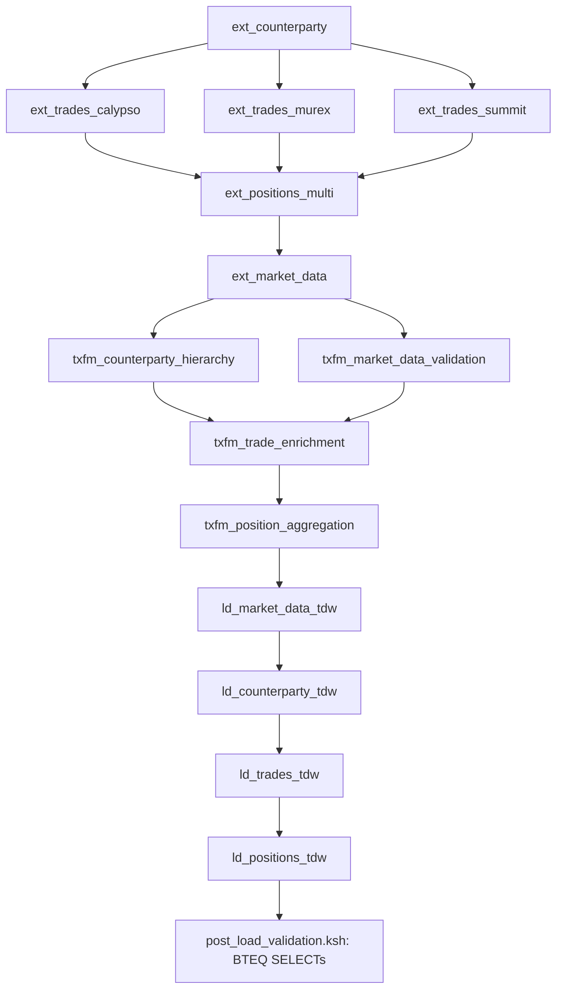
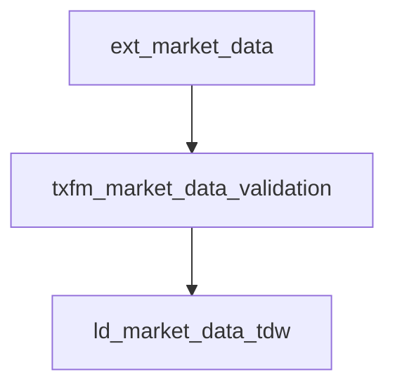

# Executable orchestration DAGs

Base commit: `2db2fb408132693d2f2dbc3680c451ce80215294` (main).
Checked-in graph count: 8. Script-referenced absent extract graph count: 6.

Static reconstruction of invocation order, not proof the absent extracts can run.
Graph nodes below are exact script graph names; validation is a non-graph node.

These are **execution-order DAGs**, not proofs of every logical data dependency. Preserve the legacy daily SERIAL load order market → counterparty → trades → positions until an owner approves a runtime change (scripts/run_daily_batch.ksh:163; scripts/run_daily_batch.ksh:166; scripts/run_daily_batch.ksh:169; scripts/run_daily_batch.ksh:172). Implementation order instead follows the approved counterparty/SCD2 pilot (s3.1/s3.2), then the remaining market/trade/position waves. Trade and position implementation may proceed in parallel once shared business-date/as-of/batch ID, FX/price and file serialization contracts are stable.

The visible position graph reads positions, FX and raw prices, not trade output; trade enrichment reads trade extracts and FX (mp/transform/txfm_position_aggregation.mp:25; mp/transform/txfm_position_aggregation.mp:68; mp/transform/txfm_position_aggregation.mp:94; mp/transform/txfm_trade_enrichment.mp:27; mp/transform/txfm_trade_enrichment.mp:210). Procedure bodies are missing, so any logical trade prerequisite for position implementation, and procedure-internal dependencies suggested by scheduler comments, remain **unproven hypotheses** (mp/load/ld_trades_tdw.mp:144; mp/load/ld_positions_tdw.mp:64). Operational serial order alone does not prove them.

## Daily

| Order / concurrency | Graph paths | Executable evidence |
|---|---|---|
| 1 | `mp/extract/ext_counterparty.mp` | scripts/run_daily_batch.ksh:101 |
| 2, parallel then wait all | `mp/extract/ext_trades_calypso.mp`, `mp/extract/ext_trades_murex.mp`, `mp/extract/ext_trades_summit.mp` | scripts/run_daily_batch.ksh:105; scripts/run_daily_batch.ksh:114 |
| 3 | `mp/extract/ext_positions_multi.mp` | scripts/run_daily_batch.ksh:124 |
| 4 | `mp/extract/ext_market_data.mp` | scripts/run_daily_batch.ksh:127 |
| 5, parallel then wait both | `mp/transform/txfm_counterparty_hierarchy.mp`, `mp/transform/txfm_market_data_validation.mp` | scripts/run_daily_batch.ksh:138; scripts/run_daily_batch.ksh:145 |
| 6 | `mp/transform/txfm_trade_enrichment.mp` | scripts/run_daily_batch.ksh:149 |
| 7 | `mp/transform/txfm_position_aggregation.mp` | scripts/run_daily_batch.ksh:152 |
| 8 | `mp/load/ld_market_data_tdw.mp` | scripts/run_daily_batch.ksh:163 |
| 9 | `mp/load/ld_counterparty_tdw.mp` | scripts/run_daily_batch.ksh:166 |
| 10 | `mp/load/ld_trades_tdw.mp` | scripts/run_daily_batch.ksh:169 |
| 11 | `mp/load/ld_positions_tdw.mp` | scripts/run_daily_batch.ksh:172 |
| 12 (not a graph) | `scripts/post_load_validation.ksh` | scripts/run_daily_batch.ksh:182; scripts/post_load_validation.ksh:32 |

## Intraday

| Order | Graph path | Executable evidence |
|---|---|---|
| 1 | `mp/extract/ext_market_data.mp` | scripts/run_intraday_refresh.ksh:43 |
| 2 | `mp/transform/txfm_market_data_validation.mp` | scripts/run_intraday_refresh.ksh:52 |
| 3 | `mp/load/ld_market_data_tdw.mp` | scripts/run_intraday_refresh.ksh:62 |

## Time, failure and restart contracts

- Daily requires ENV and BUSINESS_DATE; validates only the YYYY-MM-DD shape, not date validity, trading calendar or environment enum (scripts/run_daily_batch.ksh:22). The parameter set is sourced by legacy scripts; this inventory did not source it. CONF_FILE is assigned but never consumed (scripts/run_daily_batch.ksh:32).
- Every daily graph receives BUSINESS_DATE and a wall-clock second-resolution numeric BATCH_ID, with pset directory passed as basedir. No explicit PREV_BUSINESS_DATE is supplied, although price validation requires it (scripts/run_daily_batch.ksh:68; mp/transform/txfm_market_data_validation.mp:22). No as-of timestamp/cutoff or consistent extraction snapshot is passed. Extract query predicates cannot be recovered from absent graphs.
- Intraday passes PREV_BUSINESS_DATE equal to BUSINESS_DATE, comparing the same date-named price file to itself, not a prior refresh snapshot. It uses INTRA_ prefixed BATCH_ID while loader SQL interpolates BATCH_ID unquoted; target typing and actual failure behavior need runtime/DDL evidence (scripts/run_intraday_refresh.ksh:28; scripts/run_intraday_refresh.ksh:57; mp/load/ld_market_data_tdw.mp:48).
- Daily COB 17:30 London and intraday every two hours 07:00–18:00 London are comments, **not installed schedules or enforced cutoffs** (scripts/run_daily_batch.ksh:12; scripts/run_intraday_refresh.ksh:10). No Control>Center export or timezone/calendar implementation is checked in.
- Both wrappers use set -e but pipe commands into tee without pipefail. The captured status is normally tee's, not air's; graph failure/wait checks can therefore report success despite runtime failure (scripts/run_daily_batch.ksh:15; scripts/run_daily_batch.ksh:74; scripts/run_intraday_refresh.ksh:48). This is static shell analysis, not a reproduced failure. The post-validation wrapper also pipes to tee; the post script uses BTEQ .QUIT 0 and never interprets SQL result statuses (scripts/post_load_validation.ksh:101). Its own set -e may exit before its RC handler on BTEQ failure. Comments claiming non-fatal validation do not establish reliable error propagation.
- No checkpoint resume/phase-selection CLI exists in the wrappers. Every restart generates a new batch and runs from the first graph; checkpoints/settings alone do not prove idempotence (scripts/run_daily_batch.ksh:49; mp/load/ld_trades_tdw.mp:61; xfr/teradata_gmrd.xfr:40). Market and staging pre-cleans generally filter date **and batch**, so rerunning with new batch leaves earlier batch rows. Counterparty close/insert and gzip archive overwrite effects need explicit restart tests (mp/load/ld_counterparty_tdw.mp:102; mp/load/ld_positions_tdw.mp:78).

## Make / CI are not data DAG schedulers

Make discovers graphs by wildcard: no extract files means those silently contribute nothing to build. `all` depends on check-env, setup, validate, build; this does not serialize prerequisite recipes under parallel make. Validate checks DML via m_dml and only echoes XFR paths. Build compiles via air sandbox parameter; no daily/intraday execution or SQL cleanup is invoked (Makefile:30; Makefile:43; Makefile:65; Makefile:77).

Deploy depends on build/check-env, copies mp, dml, xfr, pset, sql, conf but **not scripts**; PROD checks GMRD_PROD_APPROVED for nonempty value, not specifically Y (Makefile:91). Setup creates extract/archive/reject paths but not data/reference (Makefile:54).

Azure validates DML, compiles present graphs with DEV pset and lints SQL with Teradata dialect. It defines develop→DEV; release/*→SIT→UAT; PROD depends on UAT but requires main while SIT requires release/*. This condition/dependency mismatch needs pipeline evidence before claiming a working main deployment route. CAB step only echoes; external environment approvals are unverified (azure-pipelines.yml:30; azure-pipelines.yml:69; azure-pipelines.yml:90; azure-pipelines.yml:108; azure-pipelines.yml:125). CI path filters omit scripts/conf/pset/docs (azure-pipelines.yml:7).

## Divergences from README, dependency diagram and comments

| Claim | Executable observation | Evidence |
|---|---|---|
| Repository contains all extracts | Six listed extracts are absent; only eight transform/load graphs exist | README.md:3; README.md:49; scripts/run_daily_batch.ksh:101 |
| Same-level graphs may run in parallel | Position then market extract are serial; trade then position transform serial; all four loads serial. This proves scheduling order, not minimal logical prerequisites | docs/graph_dependency.md:5; docs/graph_dependency.md:16; docs/graph_dependency.md:24; docs/graph_dependency.md:32; scripts/run_daily_batch.ksh:124; scripts/run_daily_batch.ksh:149; scripts/run_daily_batch.ksh:163 |
| Intraday position revaluation | Only market extract/validate/load run; no position graph or post-load validation | scripts/run_intraday_refresh.ksh:6; scripts/run_intraday_refresh.ksh:43 |
| Counterparty lookup enrichment | Reader has no consumer; generated counterparty_conformed_DATE.dat does not create counterparty_master.dat | README.md:64; mp/transform/txfm_trade_enrichment.mp:59; mp/transform/txfm_trade_enrichment.mp:210; mp/transform/txfm_counterparty_hierarchy.mp:128 |
| Greek calculations / curve interpolation | Position rollup sums supplied Greeks; price validator joins prices only, no interpolation | README.md:65; README.md:67; mp/transform/txfm_position_aggregation.mp:109; mp/transform/txfm_market_data_validation.mp:46 |
| CTR_HIERARCHY table load | Hierarchy is file lookup fields; no table writer | docs/graph_dependency.md:66; mp/transform/txfm_counterparty_hierarchy.mp:115; mp/load/ld_counterparty_tdw.mp:122 |
| Each graph has reject ports; audit/lineage and SLA alerts maintained | Only price flagged / missing-counterparty sinks explicit. No wrapper SLA alert, lineage insert or batch-completion update | docs/graph_dependency.md:81; mp/transform/txfm_market_data_validation.mp:94; mp/load/ld_counterparty_tdw.mp:133; scripts/run_daily_batch.ksh:196 |
| Cleanup SQL called before extraction; purge three business days | Wrapper never invokes cleanup. SQL subtracts calendar INTERVAL 3 DAY, not trading calendar | sql/pre_load_cleanup.sql:7; sql/pre_load_cleanup.sql:39; scripts/run_daily_batch.ksh:98 |
| Standalone SQL reconciliation is daily post-load work | Daily calls shell validation, not SQL reconciliation; shell includes Summit and prints results, SQL inserts audits and omits Summit | scripts/run_daily_batch.ksh:182; scripts/post_load_validation.ksh:54; sql/post_load_reconciliation.sql:37 |

## Environment comparison

All pset/conf files were inspected as text, never sourced. The following exhaustive key comparison lists only differing keys; credentials and connection identities/addresses are redacted even when placeholders. Runtime consumption of conf is unverified: wrappers do not read it. Common pset keys include the directory aliases and stale/outlier thresholds; common conf keys include checkpoint_enabled, record_count_logging, charset, mode and compression. See comparison below for effective alias path changes via AB_SANDBOX.

### pset differences (DEV / SIT / UAT / PROD)

| Key | DEV | SIT | UAT | PROD |
|---|---|---|---|---|
| AB_SANDBOX | /data/gmrd/dev (pset/dev/gmrd_daily.pset:12) | /data/gmrd/sit (pset/sit/gmrd_daily.pset:8) | /data/gmrd/uat (pset/uat/gmrd_daily.pset:8) | /data/gmrd/prod (pset/prod/gmrd_daily.pset:9) |
| BATCH_SIZE | 10000 (pset/dev/gmrd_daily.pset:51) | 25000 (pset/sit/gmrd_daily.pset:40) | 50000 (pset/uat/gmrd_daily.pset:40) | 50000 (pset/prod/gmrd_daily.pset:41) |
| BBG_FEED_DIR | /data/feeds/bloomberg/dev (pset/dev/gmrd_daily.pset:35) | /data/feeds/bloomberg/sit (pset/sit/gmrd_daily.pset:26) | /data/feeds/bloomberg/uat (pset/uat/gmrd_daily.pset:26) | /data/feeds/bloomberg/prod (pset/prod/gmrd_daily.pset:27) |
| CALYPSO_JDBC_URL | [REDACTED] (pset/dev/gmrd_daily.pset:20) | [REDACTED] (pset/sit/gmrd_daily.pset:14) | [REDACTED] (pset/uat/gmrd_daily.pset:14) | [REDACTED] (pset/prod/gmrd_daily.pset:15) |
| CALYPSO_PASSWORD | [REDACTED] (pset/dev/gmrd_daily.pset:22) | [REDACTED] (pset/sit/gmrd_daily.pset:16) | [REDACTED] (pset/uat/gmrd_daily.pset:16) | [REDACTED] (pset/prod/gmrd_daily.pset:17) |
| CALYPSO_USER | [REDACTED] (pset/dev/gmrd_daily.pset:21) | [REDACTED] (pset/sit/gmrd_daily.pset:15) | [REDACTED] (pset/uat/gmrd_daily.pset:15) | [REDACTED] (pset/prod/gmrd_daily.pset:16) |
| ENV | dev (pset/dev/gmrd_daily.pset:11) | sit (pset/sit/gmrd_daily.pset:7) | uat (pset/uat/gmrd_daily.pset:7) | prod (pset/prod/gmrd_daily.pset:8) |
| FETCH_SIZE | 5000 (pset/dev/gmrd_daily.pset:50) | 10000 (pset/sit/gmrd_daily.pset:39) | 10000 (pset/uat/gmrd_daily.pset:39) | 10000 (pset/prod/gmrd_daily.pset:40) |
| LOG_LEVEL | DEBUG (pset/dev/gmrd_daily.pset:58) | INFO (pset/sit/gmrd_daily.pset:46) | INFO (pset/uat/gmrd_daily.pset:46) | WARN (pset/prod/gmrd_daily.pset:47) |
| MAX_PARALLELISM | 2 (pset/dev/gmrd_daily.pset:48) | 4 (pset/sit/gmrd_daily.pset:37) | 4 (pset/uat/gmrd_daily.pset:37) | 8 (pset/prod/gmrd_daily.pset:38) |
| MAX_SESSIONS | 4 (pset/dev/gmrd_daily.pset:49) | 8 (pset/sit/gmrd_daily.pset:38) | 12 (pset/uat/gmrd_daily.pset:38) | 16 (pset/prod/gmrd_daily.pset:39) |
| MUREX_JDBC_URL | [REDACTED] (pset/dev/gmrd_daily.pset:25) | [REDACTED] (pset/sit/gmrd_daily.pset:18) | [REDACTED] (pset/uat/gmrd_daily.pset:18) | [REDACTED] (pset/prod/gmrd_daily.pset:19) |
| MUREX_PASSWORD | [REDACTED] (pset/dev/gmrd_daily.pset:27) | [REDACTED] (pset/sit/gmrd_daily.pset:20) | [REDACTED] (pset/uat/gmrd_daily.pset:20) | [REDACTED] (pset/prod/gmrd_daily.pset:21) |
| MUREX_USER | [REDACTED] (pset/dev/gmrd_daily.pset:26) | [REDACTED] (pset/sit/gmrd_daily.pset:19) | [REDACTED] (pset/uat/gmrd_daily.pset:19) | [REDACTED] (pset/prod/gmrd_daily.pset:20) |
| RTR_FEED_DIR | /data/feeds/reuters/dev (pset/dev/gmrd_daily.pset:36) | /data/feeds/reuters/sit (pset/sit/gmrd_daily.pset:27) | /data/feeds/reuters/uat (pset/uat/gmrd_daily.pset:27) | /data/feeds/reuters/prod (pset/prod/gmrd_daily.pset:28) |
| SUMMIT_JDBC_URL | [REDACTED] (pset/dev/gmrd_daily.pset:30) | [REDACTED] (pset/sit/gmrd_daily.pset:22) | [REDACTED] (pset/uat/gmrd_daily.pset:22) | [REDACTED] (pset/prod/gmrd_daily.pset:23) |
| SUMMIT_PASSWORD | [REDACTED] (pset/dev/gmrd_daily.pset:32) | [REDACTED] (pset/sit/gmrd_daily.pset:24) | [REDACTED] (pset/uat/gmrd_daily.pset:24) | [REDACTED] (pset/prod/gmrd_daily.pset:25) |
| SUMMIT_USER | [REDACTED] (pset/dev/gmrd_daily.pset:31) | [REDACTED] (pset/sit/gmrd_daily.pset:23) | [REDACTED] (pset/uat/gmrd_daily.pset:23) | [REDACTED] (pset/prod/gmrd_daily.pset:24) |
| TD_JDBC_URL | [REDACTED] (pset/dev/gmrd_daily.pset:15) | [REDACTED] (pset/sit/gmrd_daily.pset:10) | [REDACTED] (pset/uat/gmrd_daily.pset:10) | [REDACTED] (pset/prod/gmrd_daily.pset:11) |
| TD_PASSWORD | [REDACTED] (pset/dev/gmrd_daily.pset:17) | [REDACTED] (pset/sit/gmrd_daily.pset:12) | [REDACTED] (pset/uat/gmrd_daily.pset:12) | [REDACTED] (pset/prod/gmrd_daily.pset:13) |
| TD_USER | [REDACTED] (pset/dev/gmrd_daily.pset:16) | [REDACTED] (pset/sit/gmrd_daily.pset:11) | [REDACTED] (pset/uat/gmrd_daily.pset:11) | [REDACTED] (pset/prod/gmrd_daily.pset:12) |

### conf differences (DEV / SIT / UAT / PROD)

| Key | DEV | SIT | UAT | PROD |
|---|---|---|---|---|
| alert_email | gmrd-dev-alerts@group.internal (conf/dev/abinitio.cfg:40) | gmrd-sit-alerts@group.internal (conf/sit/abinitio.cfg:40) | gmrd-uat-alerts@group.internal (conf/uat/abinitio.cfg:40) | gmrd-prod-alerts@group.internal (conf/prod/abinitio.cfg:40) |
| archive_dir | /data/gmrd/dev/data/archive (conf/dev/abinitio.cfg:48) | /data/gmrd/sit/data/archive (conf/sit/abinitio.cfg:48) | /data/gmrd/uat/data/archive (conf/uat/abinitio.cfg:49) | /data/gmrd/prod/data/archive (conf/prod/abinitio.cfg:49) |
| archive_retention_days | 7 (conf/dev/abinitio.cfg:49) | 30 (conf/sit/abinitio.cfg:49) | 60 (conf/uat/abinitio.cfg:50) | 90 (conf/prod/abinitio.cfg:50) |
| bloomberg_dir | /data/feeds/bloomberg/dev (conf/dev/abinitio.cfg:33) | /data/feeds/bloomberg/sit (conf/sit/abinitio.cfg:33) | /data/feeds/bloomberg/uat (conf/uat/abinitio.cfg:33) | /data/feeds/bloomberg/prod (conf/prod/abinitio.cfg:33) |
| calypso_extract_dir | /data/feeds/calypso/dev (conf/dev/abinitio.cfg:35) | /data/feeds/calypso/sit (conf/sit/abinitio.cfg:35) | /data/feeds/calypso/uat (conf/uat/abinitio.cfg:35) | /data/feeds/calypso/prod (conf/prod/abinitio.cfg:35) |
| checkpoint_dir | /data/gmrd/dev/checkpoint (conf/dev/abinitio.cfg:21) | /data/gmrd/sit/checkpoint (conf/sit/abinitio.cfg:21) | /data/gmrd/uat/checkpoint (conf/uat/abinitio.cfg:21) | /data/gmrd/prod/checkpoint (conf/prod/abinitio.cfg:21) |
| environment | DEV (conf/dev/abinitio.cfg:10) | SIT (conf/sit/abinitio.cfg:10) | UAT (conf/uat/abinitio.cfg:10) | PROD (conf/prod/abinitio.cfg:10) |
| escalation_email | [ABSENT] (conf/dev/abinitio.cfg:1) | [ABSENT] (conf/sit/abinitio.cfg:1) | gmrd-dataeng@group.internal (conf/uat/abinitio.cfg:41) | gmrd-oncall@group.internal (conf/prod/abinitio.cfg:41) |
| log_level | DEBUG (conf/dev/abinitio.cfg:12) | INFO (conf/sit/abinitio.cfg:12) | INFO (conf/uat/abinitio.cfg:12) | WARN (conf/prod/abinitio.cfg:12) |
| max_memory_mb | 4096 (conf/dev/abinitio.cfg:18) | 8192 (conf/sit/abinitio.cfg:18) | 12288 (conf/uat/abinitio.cfg:18) | 16384 (conf/prod/abinitio.cfg:18) |
| max_parallelism | 2 (conf/dev/abinitio.cfg:17) | 4 (conf/sit/abinitio.cfg:17) | 4 (conf/uat/abinitio.cfg:17) | 8 (conf/prod/abinitio.cfg:17) |
| max_temp_space_gb | 50 (conf/dev/abinitio.cfg:19) | 100 (conf/sit/abinitio.cfg:19) | 200 (conf/uat/abinitio.cfg:19) | 500 (conf/prod/abinitio.cfg:19) |
| murex_extract_dir | /data/feeds/murex/dev (conf/dev/abinitio.cfg:36) | /data/feeds/murex/sit (conf/sit/abinitio.cfg:36) | /data/feeds/murex/uat (conf/uat/abinitio.cfg:36) | /data/feeds/murex/prod (conf/prod/abinitio.cfg:36) |
| reuters_dir | /data/feeds/reuters/dev (conf/dev/abinitio.cfg:34) | /data/feeds/reuters/sit (conf/sit/abinitio.cfg:34) | /data/feeds/reuters/uat (conf/uat/abinitio.cfg:34) | /data/feeds/reuters/prod (conf/prod/abinitio.cfg:34) |
| sandbox | /data/gmrd/dev (conf/dev/abinitio.cfg:11) | /data/gmrd/sit (conf/sit/abinitio.cfg:11) | /data/gmrd/uat (conf/uat/abinitio.cfg:11) | /data/gmrd/prod (conf/prod/abinitio.cfg:11) |
| serial_dir | /data/gmrd/dev/serial (conf/dev/abinitio.cfg:14) | /data/gmrd/sit/serial (conf/sit/abinitio.cfg:14) | /data/gmrd/uat/serial (conf/uat/abinitio.cfg:14) | /data/gmrd/prod/serial (conf/prod/abinitio.cfg:14) |
| sla_load_mins | 60 (conf/dev/abinitio.cfg:44) | 45 (conf/sit/abinitio.cfg:44) | 45 (conf/uat/abinitio.cfg:45) | 45 (conf/prod/abinitio.cfg:45) |
| sla_total_batch_mins | 300 (conf/dev/abinitio.cfg:45) | 240 (conf/sit/abinitio.cfg:45) | 210 (conf/uat/abinitio.cfg:46) | 180 (conf/prod/abinitio.cfg:46) |
| sla_trade_extract_mins | 60 (conf/dev/abinitio.cfg:41) | 60 (conf/sit/abinitio.cfg:41) | 45 (conf/uat/abinitio.cfg:42) | 45 (conf/prod/abinitio.cfg:42) |
| sla_transform_mins | 60 (conf/dev/abinitio.cfg:43) | 45 (conf/sit/abinitio.cfg:43) | 30 (conf/uat/abinitio.cfg:44) | 30 (conf/prod/abinitio.cfg:44) |
| summit_extract_dir | /data/feeds/summit/dev (conf/dev/abinitio.cfg:37) | /data/feeds/summit/sit (conf/sit/abinitio.cfg:37) | /data/feeds/summit/uat (conf/uat/abinitio.cfg:37) | /data/feeds/summit/prod (conf/prod/abinitio.cfg:37) |
| temp_dir | /data/gmrd/dev/tmp (conf/dev/abinitio.cfg:13) | /data/gmrd/sit/tmp (conf/sit/abinitio.cfg:13) | /data/gmrd/uat/tmp (conf/uat/abinitio.cfg:13) | /data/gmrd/prod/tmp (conf/prod/abinitio.cfg:13) |
| teradata_host | [REDACTED] (conf/dev/abinitio.cfg:25) | [REDACTED] (conf/sit/abinitio.cfg:25) | [REDACTED] (conf/uat/abinitio.cfg:25) | [REDACTED] (conf/prod/abinitio.cfg:25) |
| teradata_max_sessions | 4 (conf/dev/abinitio.cfg:30) | 8 (conf/sit/abinitio.cfg:30) | 12 (conf/uat/abinitio.cfg:30) | 16 (conf/prod/abinitio.cfg:30) |

Directory alias keys OUTPUT_DIR, EXTRACT_DIR, INPUT_DIR and LOOKUP_DIR all equal ${AB_SANDBOX}/data/extract; REJECT_DIR, ARCHIVE_DIR, HIERARCHY_FILE and LOG_DIR also inherit the environment sandbox. Literal expressions match, effective paths differ. Credential placeholders with identical literal values are intentionally not reproduced. pset/dev/gmrd_daily.pset:39; pset/sit/gmrd_daily.pset:29; pset/uat/gmrd_daily.pset:29; pset/prod/gmrd_daily.pset:30.
