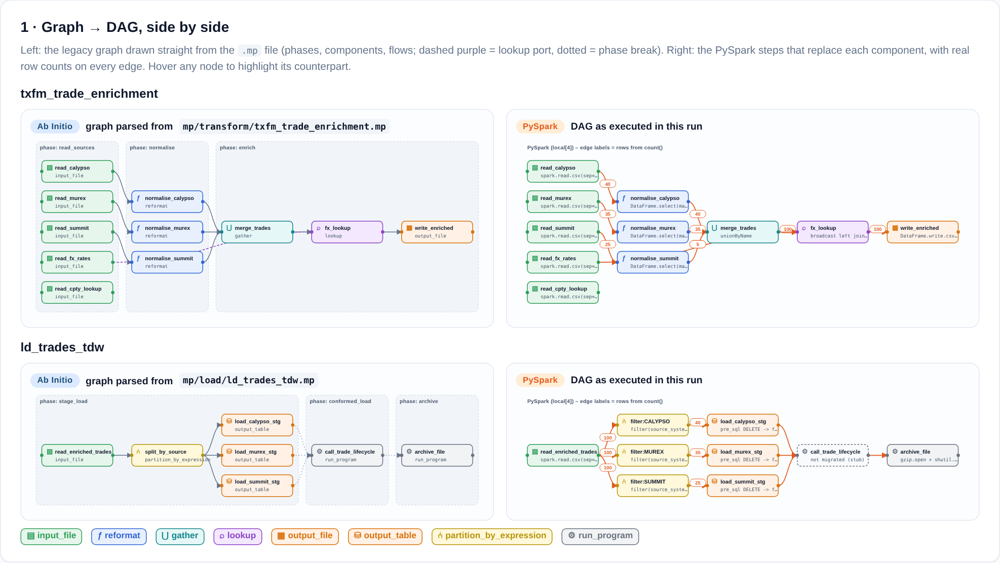

# Ab Initio → PySpark migration demo (GMRD)

Ports two graphs from this repo to PySpark, runs them locally on synthetic data, and builds a single
self-contained HTML page that puts the legacy graph and the PySpark version side by side.

| Legacy graph | PySpark module |
|---|---|
| `mp/transform/txfm_trade_enrichment.mp` | `gmrd_spark/txfm_trade_enrichment.py` |
| `mp/load/ld_trades_tdw.mp` (stage_load + archive phases) | `gmrd_spark/ld_trades_tdw.py` |

The Ab Initio sources are not modified.



## Run

Needs Python 3.10+ and Java 17+.

```bash
cd pyspark_migration
python -m venv .venv && . .venv/bin/activate
pip install -r requirements.txt
python run_demo.py          # synthetic data -> both graphs -> work/results/run_results.json (exit 1 if a check fails)
python build_report.py      # -> report/abinitio_to_pyspark_demo.html (open it in a browser)
pytest -q tests             # end-to-end parity / row-count tests
# optional: screenshots of the report
python -m playwright install chromium && python scripts/screenshot_report.py
```

## Layout

| Path | What it is |
|---|---|
| `gmrd_spark/dml.py` | Parses the repo's `.dml` record types into Spark schemas at runtime |
| `gmrd_spark/mp_graph.py` | Reads the `.mp` graphs (components, phases, flows) for the diagrams and mapping |
| `gmrd_spark/txfm_trade_enrichment.py` | input_file → `spark.read.csv`, reformat → `select`, gather → `unionByName`, lookup → broadcast join, output_file → `write.csv` |
| `gmrd_spark/ld_trades_tdw.py` | partition_by_expression → `filter`, output_table (pre_sql DELETE + stream INSERT) → filter + union + Parquet, archive → gzip |
| `gmrd_spark/reference_rules.py` | Independent, Spark-free Python implementation of the enrichment rules, used as the cross-check |
| `gmrd_spark/lineage.py` | Records each PySpark step against the Ab Initio component it replaces, with real `count()`s |
| `scripts/generate_synthetic_data.py` | Seeded synthetic Calypso / Murex / Summit / FX / counterparty extracts laid out from the DML |
| `run_demo.py` / `build_report.py` | Run everything and build the HTML report |
| `report/abinitio_to_pyspark_demo.html` | Generated report (committed so it can be opened without running anything) |
| `docs/screenshots/` | Screenshots of the report |

`work/` holds generated data and outputs and is git-ignored.

## Scope and caveats

- **All data is synthetic.** It is generated from the DML layouts with a fixed seed.
- **No Ab Initio runtime or Teradata was available.** Nothing here compares against real Ab Initio output. "Parity" means
  the PySpark output matches an independent Python implementation of the same rules cell by cell, and row counts / control
  totals reconcile at every stage.
- GMRD_STG_DB staging tables are emulated as local Parquet directories. The `conformed_load` phase
  (`BTEQ CALL GMRD_CORE_DB.SP_TRADE_LIFECYCLE`) is a Teradata stored procedure and is recorded as a stub, not migrated.
- The port keeps the legacy behaviour as-is, including the quirks listed in section 6 of the report (for example, Murex and
  Summit rows get no `asset_class`, and rerunning the same batch duplicates staged rows because of how the `pre_sql` DELETE filters).
